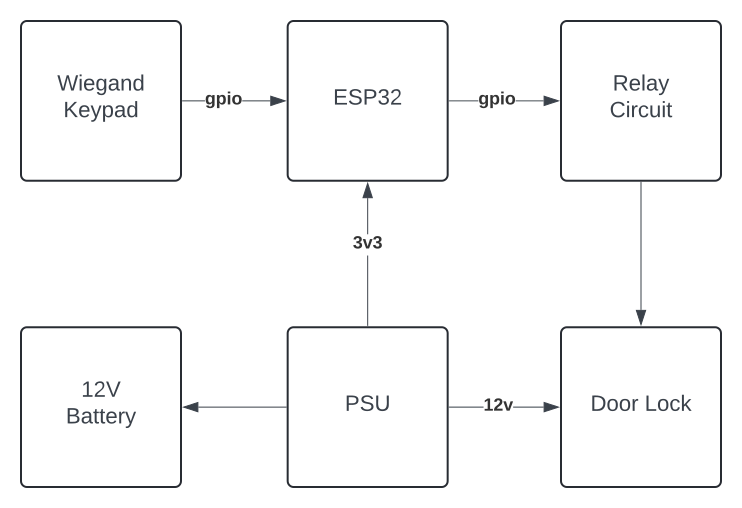
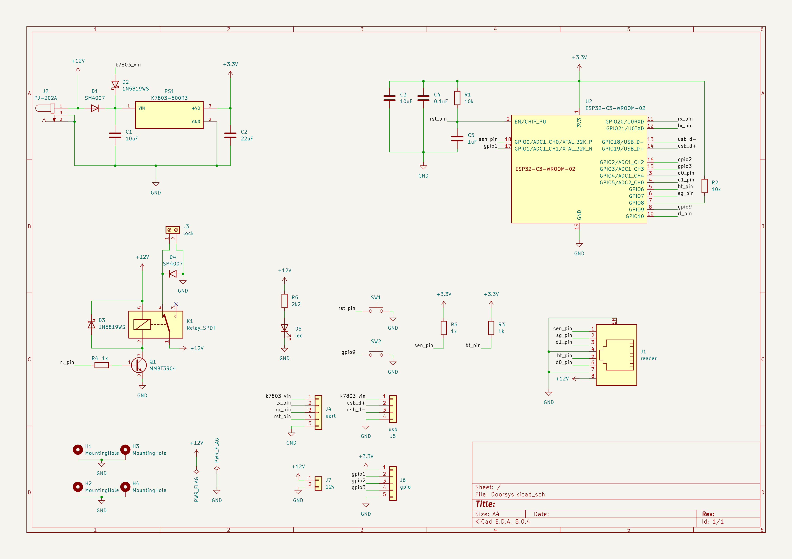
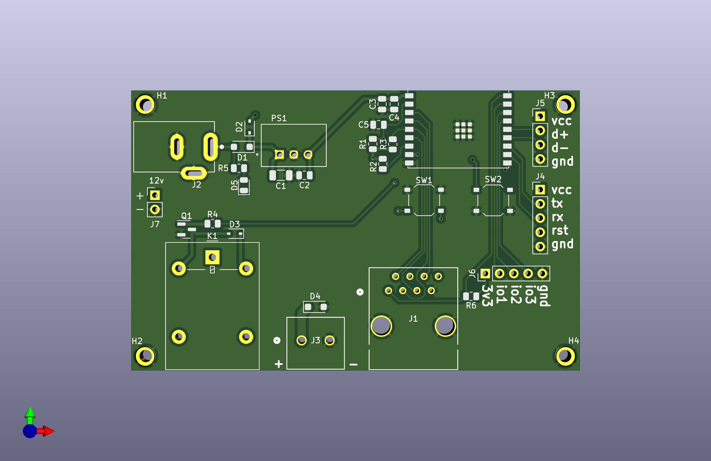
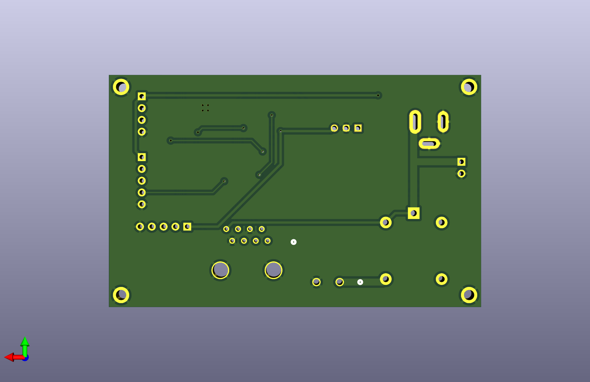
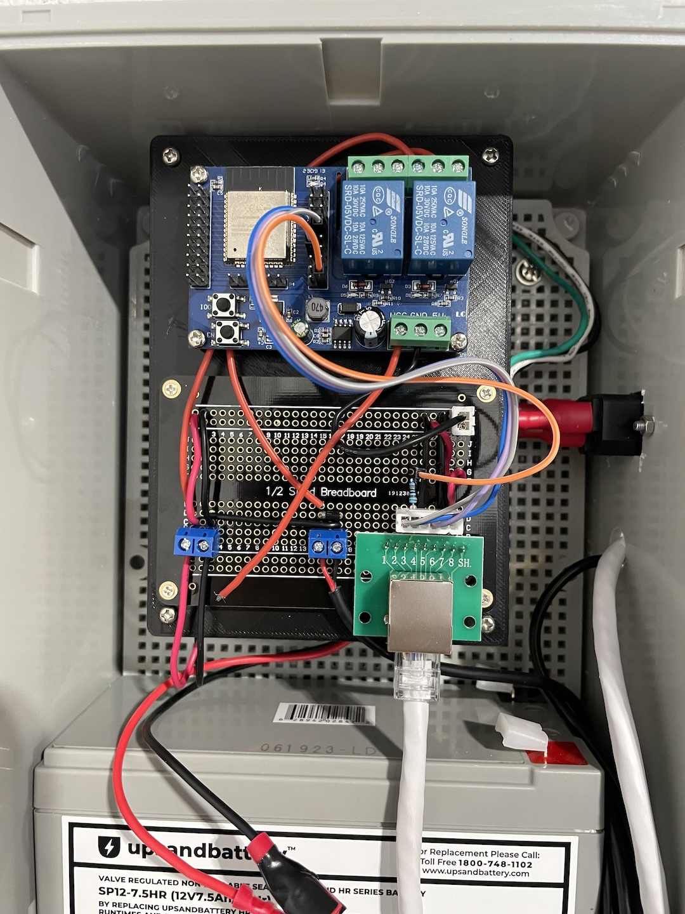
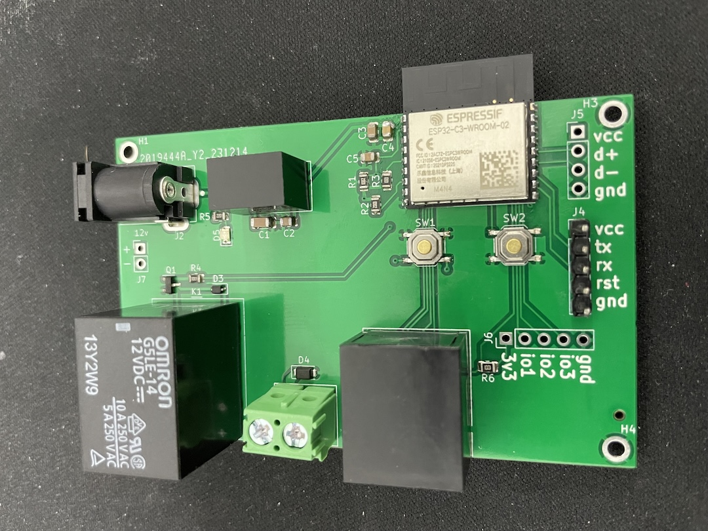
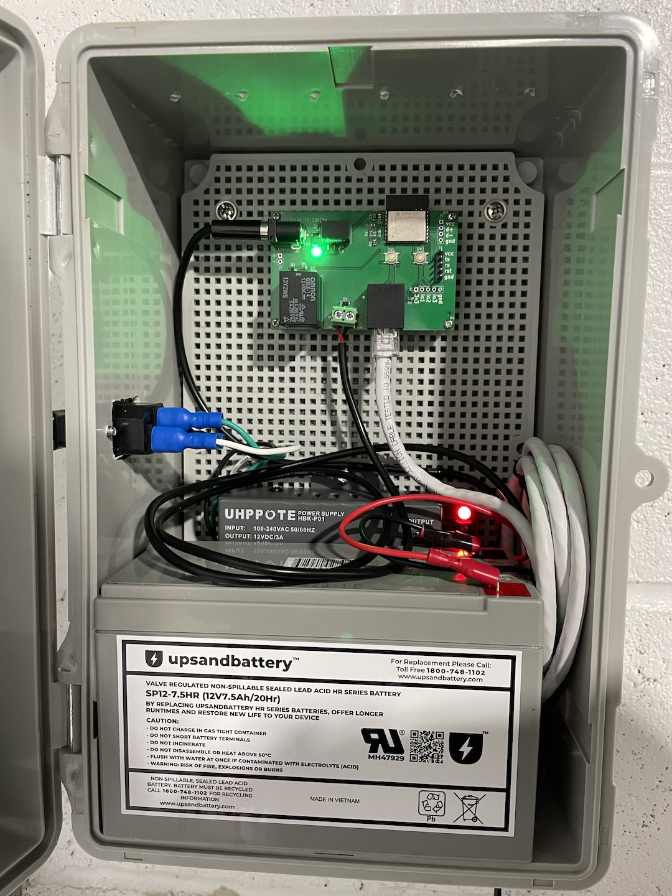

<!-- vim: set tw=80: -->

# Doorsys hardware

This repository contains schematics, hardware breakdown, and designs for the
custom PCB for the Doorsys device.

Earlier versions of this project used a ESP32 relay board and a soldered
protoboard. That wasn't very clean as you can see in the [pictures](#pictures)
section.

## Overview

The ESP32 is connected to a relay using GPIO in order to operate the 12v based
magnetic lock. A [wiegand](https://en.wikipedia.org/wiki/Wiegand_interface)
keypad is also connected to the ESP32 using 2 GPIO ports. A 12v PSU with an
external 12V battery was added for continuous operation in face of a power
outage. More information, schematics, and PCB design can be found on the
[doorsys-hardware](https://github.com/fabiojmendes/doorsys-hardware) repository.

## Block diagram



## Schematics

After transitioning from the ESP32 chip in favor of the ESP32-C3 for better
compatibility with rust (ESP32-C3 is based on the RISC-V architecture) a custom
board was necessary.

This board design is based on the reference implementation provided by the
ESP32-C3 WROOM module
[datasheet](https://www.espressif.com/sites/default/files/documentation/esp32-c3-wroom-02_datasheet_en.pdf).



## Important remarks

- A DC-DC regulator is used to drop the voltage from 12v used by the door lock
  to the 3v3 used by the esp chip
- The onboard relay is driven by a transistor and contains flyback diodes to
  manage the voltage spikes coming from the lock
- GPIO 4 and 5 are connected D0 and D1 respectively on the keypad
- GPIO 10 is connected to the relay for door activation
- Headers for the UART and USB ports are available
- Extra GPIOs are available on optional header pins

> [!WARNING]
> Spec wise the ESP32 family is not 5v logic tolerant. While there is
> [chatter](https://www.letscontrolit.com/forum/viewtopic.php?t=8845) on the
> internet claiming otherwise, the Wiegand data lines now include inline
> Schottky diodes inside the [reader cable](#reader-cable) for voltage level
> translation to avoid cutting traces on the rev 1 PCB.

## Reader cable

The keypad connects to the PCB via a custom Cat6 cable terminated with an RJ45
plug on the board side (`J1`) and a 6-pin JST-SM connector on the keypad side:

```text
  PCB (J1)                                                          Keypad
  RJ45 (8P8C)                 Cat6 Cable                          JST-SM (6-pin)
                                                                (Latch up, L -> R)
+--------------+                                                +----------------+
| 1  sen_pin   |--- White/Orange (NC)                           |                |
|              |                                         +----->| 1  Red   (12V) |
| 2  sg_pin    |--- Blue -------------------+            |      |                |
|              |                            |     +------|-<|-->| 2  White (D1)  |
| 3  d1_pin    |--- Orange -----------------|-----+      |      |                |
|              |                            |            |      |                |
| 4  GND       |--- White/Green  (NC)       |     +------|-<|-->| 3  Green (D0)  |
| 5  bt_pin    |--- White/Blue   (NC)       |     |      |      |                |
|              |                            |     |      |   +->| 4  Blue  (LED) |
| 6  d0_pin    |--- Green ------------------|-----+      |   |  |                |
|              |                            +------------|---+->| 5  Yel   (Buz) |
| 7  GND       |--- White/Brown -------------------------|----->| 6  Black (GND) |
|              |                                         |      |                |
| 8  +12V      |--- Brown -------------------------------+      +----------------+
+--------------+

                JST-SM Pinout (Latch facing up, counting L -> R)
                                   +-------+
                                   | Latch |
                      +------------+-------+------------+
                      | [1]   [2]   [3]   [4]   [5]   [6] |
                      +-----------------------------------+
                         |     |     |     |     |     |
                        Red  White Green Blue   Yel  Black
                       (12V)  (D1)  (D0) (LED) (Buz) (GND)
                                          \___/
                                          Jumped
```

### Design changes

1. **Unpaired single-ended data lines (crosstalk mitigation):** Initially, the
   cable followed the standard T568B pinout using the `Green` / `White/Green`
   twisted pair for `D0` and `D1` because it matched the keypad wire colors.
   However, Wiegand uses single-ended (non-differential) signaling, so running
   `D0` and `D1` twisted together in the same pair degraded signal integrity due
   to capacitive coupling/crosstalk. Each active signal now uses a single
   solid-colored wire from a separate twisted pair (`Green` and `Orange` for
   data, `Blue` for signal), while the striped mate wires (`White/Blue`,
   `White/Orange`, `White/Green`) are left disconnected.
2. **Inline voltage level translation:** Two reverse-biased Schottky diodes
   (`1N5819` or equivalent) are soldered inline on the `D0` (`Green`) and `D1`
   (`Orange`) lines before the JST-SM connector. This drops/blocks the keypad's
   5V logic level down to a safe level for the ESP32-C3 GPIOs without having to
   cut traces on the PCB.
3. **Jumped LED & Buzzer feedback:** The Cat6 `Blue` signal wire (`sg_pin`) is
   jumped across both the `Blue` (LED, pin 4) and `Yellow` (Buzzer, pin 5) pins
   on the 6-pin JST-SM connector so a single GPIO drives both visual and audible
   feedback.

### Pinout & wiring table

The RJ45 plug uses a **custom crimp order** (modified from T568B) so the
reassigned Cat6 wires land on the existing PCB pins of `J1`. JST-SM pins are
numbered `1` to `6` from left to right with the locking latch facing up:

| RJ45 Pin | PCB Net (`J1`) | ESP32-C3 Pin | Cat6 Wire Color | Original T568B |   Inline Component   | JST-SM Pin (L->R) | Keypad Wire                          |
| :------: | :------------- | :----------- | :-------------- | :------------- | :------------------: | :---------------: | :----------------------------------- |
|  **1**   | `sen_pin`      | GPIO 0       | White/Orange    | White/Orange   |          —           |         —         | _Unused (NC)_                        |
|  **2**   | `sg_pin`       | GPIO 7       | **Blue**        | Orange         |   Jumped (1-to-2)    |      **4 & 5**    | **Blue** (LED) + **Yellow** (Buzzer) |
|  **3**   | `d1_pin`       | GPIO 5       | **Orange**      | White/Green    | `<\|` Schottky diode |       **2**       | **White** (Wiegand `D1`)             |
|  **4**   | `GND`          | GND          | White/Green     | Blue           |          —           |         —         | _Unused (NC)_                        |
|  **5**   | `bt_pin`       | GPIO 6       | White/Blue      | White/Blue     |          —           |         —         | _Unused (NC)_                        |
|  **6**   | `d0_pin`       | GPIO 4       | **Green**       | Green          | `<\|` Schottky diode |       **3**       | **Green** (Wiegand `D0`)             |
|  **7**   | `GND`          | GND          | **White/Brown** | White/Brown    |          —           |       **6**       | **Black** (`GND`)                    |
|  **8**   | `+12V`         | —            | **Brown**       | Brown          |          —           |       **1**       | **Red** (`+12V`)                     |

## TODO

List of recommended changes for the next revision of the board:

- Change mounting holes to M3
- Add level shifting circuit to wiegand reader
- Add pull-up resistors to wiegand reader
- Add TVS diodes to wiegand reader and USB
- Add USB-C connector
- Remove RJ45 connector and use JST-XH instead
- Add 3 pin connector for door activation using NC and NO pins
  - Also increase pad sizes
- Move door connector away from the rest of the circuit
- Remove button and sensor pins and move it to general IO pins
- Consider adding a LDO (Diodes Inc. AP2112K-3.3TRG1) to the power supply design

## Printed circuit board

Here is the PCB design:

 

## Pictures

Prototype board using ESP32 

PCB fully assembled and migrated to ESP32-C3


New PCB installed and running 
